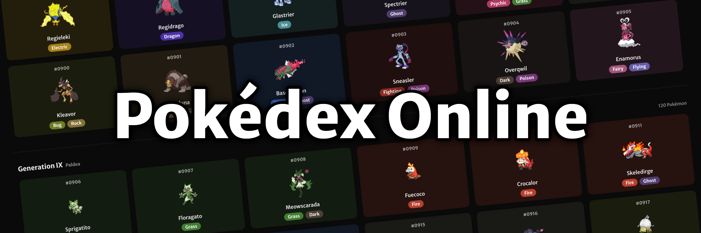

<div align="center">
    
</div>

This is an informative Pokédex viewer built with [Next.js](https://nextjs.org). It fetches data from the popular [PokéAPI](https://pokeapi.co/) to ensure data is automatically up to date as new games release. Pokémon are split between generation, and data is fetched at compile time, to reduce browser overhead.

The app gives you helpful information about Pokémon and serves as a resource for those who are either looking for information about their favourite Pokémon, or trying to catch 'em all in the newest game.

We follow the [PokéAPI fair use policy](https://pokeapi.co/v2#fair-use-policy). We cache resources as much as possible, and request data from GitHub when it exists there. We try to be as respectful to PokéAPI as much as possible with the knowledge that they supply data for countless other sites and apps.

## Requirements

* install [Node.js and npm](https://nodejs.org/en)

## Build

```bash
npm i           # install dependencies
npm run build   # build to .next/server/app/
npm run serve   # run development server
```
